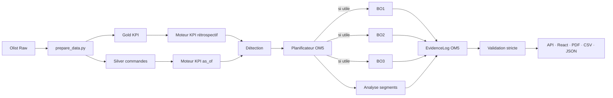
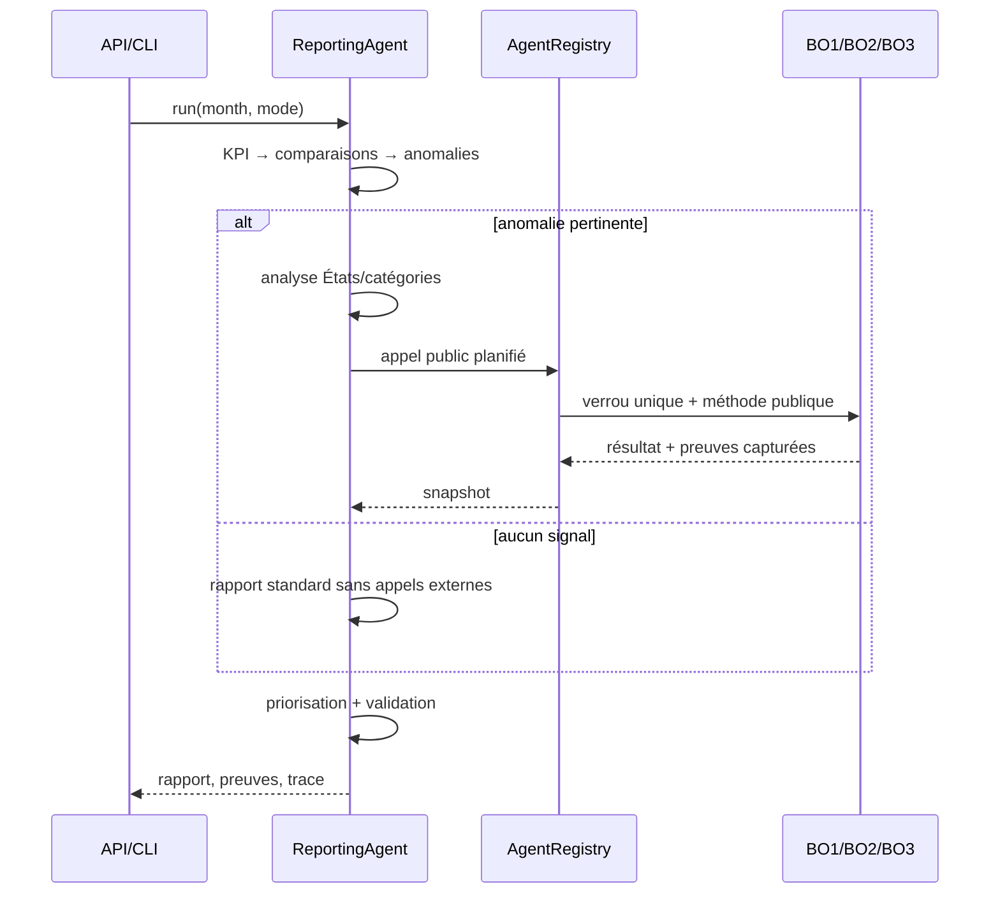

# Architecture OM5

> Mise à jour LangGraph: le graphe compilé réel est versionné dans [`om5_graph.mmd`](om5_graph.mmd).

## Architecture exécutée

`ReportingAgent.run(month, mode, include_agents)` initialise `OM5State`, puis invoque un `StateGraph` compilé. Les nœuds KPI, comparaisons et détection utilisent les fonctions historiques existantes. Le routeur saute segments et collaborateurs en l'absence d'anomalie. Le planificateur applique les règles BO1/BO2/BO3; les appels passent séquentiellement par `AgentRegistry.call_public`.

Après consolidation, le score `100 × (0,45 × amplitude + 0,35 × confiance + 0,20 × volume)` est figé. `GeminiOM5Generator` reçoit un contexte JSON compact. Le validateur accepte la sortie, la renvoie une fois pour correction ou route vers le repli déterministe.

Fichiers: `om5_state.py` (état), `om5_graph.py` (graphe), `om5_generator.py` (SDK et Pydantic), `om5_prompts.py` (grounding), `om5_validation.py` (contrôles métier), `om5_reports.py` (présentation PDF).

## Objectif

OM5 transforme les agrégats Olist en un dispositif d'aide à la décision traçable : observer les KPI, détecter un écart inhabituel, choisir les investigations utiles, consolider les agents existants, valider les preuves et produire un rapport global.

## Workflow autonome

1. **Observation** : charge le mois et le mode temporel.
2. **Détection** : compare au mois précédent, à la fenêtre historique et à N−12 si disponible.
3. **Planification** : sélectionne les segments et agents selon les KPI dégradés.
4. **Exécution** : applique budget, déduplication, erreurs capturées et appels séquentiels.
5. **Consolidation** : espace les identifiants `om5:bo1:`, `om5:bo2:` et `om5:bo3:`.
6. **Validation** : vérifie références, chiffres, unités, période et absence de causalité non démontrée.
7. **Reporting** : produit un rapport complet ou explicitement partiel.

## Contrats publics

- `ReportingAgent.run(month, mode, include_agents)` : workflow complet.
- `get_monthly_kpis`, `compare_periods`, `detect_kpi_anomalies`, `analyze_segments` : outils structurés.
- `/api/om5/meta|kpis|trends|anomalies|segments|report|ask` : consultation.
- `/api/om5/report.pdf|kpis.csv|evidence.csv` : exports.
- `src/run_om5.py` : replay périodique mono-mois ou batch.

## Tolérance aux pannes

Chaque erreur d'agent est inscrite dans `tool_trace`; les autres investigations continuent. `partial=true` interdit de confondre le rapport avec une exécution complète. Un budget maximal de huit appels et une clé `(outil, paramètres)` préviennent les boucles et doublons. OM5 ne tient jamais plusieurs verrous collaborateurs simultanément.

