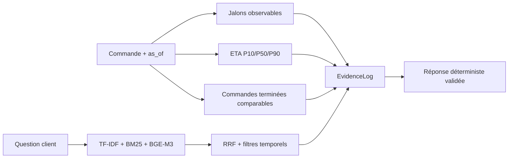

# BO4 — Assistant client fondé sur des preuves

## 1. Compréhension métier

BO4 explique une commande Olist à une date historique explicite (`as_of`). Il sépare faits observables, estimations, expériences historiques et actions. Olist n'est pas un suivi temps réel : aucune position GPS, cause exacte ou politique de remboursement n'est déduite.



## 2. Compréhension des données

Entrées : `features_{train,valid,test}.csv.gz`, `orders_analysis.csv.gz`, `reviews_text.jsonl.gz` et sa traduction française. La date individuelle `review_answered_at` (ou `review_created_at`) détermine la disponibilité d'un avis. Une issue n'est disponible qu'à `order_delivered_customer_date`.

Les données préparées ne sont pas versionnées et sont absentes du présent checkout. Aucun score scientifique n'est donc publié ; les fixtures synthétiques servent uniquement aux tests logiciels.

## 3. Préparation et audit de fuite

Les encodages cibles BO1/BO2 sont exclus : leurs plis OOF mélangés permettent à une observation ancienne d'utiliser des issues futures. BO4 conserve les variables disponibles à l'approbation, joint la cible par `order_id` et exige que l'issue ait été observée avant le fitting. Découpage : train octobre 2016–décembre 2017, sélection janvier–février 2018, calibration mars 2018, test avril–août 2018.

## 4. Modélisation et évaluation

Le benchmark compare quantiles globaux et régionaux, régression quantile linéaire, Gradient Boosting et LightGBM. Le critère combine Winkler et écart à la couverture 80 %. Le modèle choisi est réentraîné jusqu'au 1er mars puis conformalisé sur mars. Les durées négatives sont tronquées et les quantiles croisés remis en ordre. Un intervalle dépassé n'est jamais présenté comme ETA actuelle ; aucun modèle de temps restant n'est revendiqué.

Mesures : MAE, RMSE, pinball P10/P50/P90, PICP, MPIW et Winkler, globalement et par mois, État et nombre de vendeurs. La promesse marketplace est comparée séparément.

## 5. Recherche hybride

`HistoricalReviewIndex` reconstruit le corpus disponible à `as_of`, recalcule TF-IDF et BM25 sur ce snapshot, ajoute facultativement BGE-M3, puis fusionne par RRF. Les filtres région/catégorie sont relâchés progressivement. Un résultat sans pertinence minimale n'est pas ajouté pour remplir `top-k`. Les commandes comparables doivent être livrées avant `as_of` et la cible est exclue.

`evaluate_bo4.py` produit 100 questions bilingues et un gabarit d'annotation. Precision@5, Recall@5, MRR et nDCG@5 ne doivent être calculés qu'après jugements humains ; le résultat reste explicitement en attente jusque-là.

## 6. Déploiement et sécurité

`CustomerAssistantAgent` expose `get_order_context`, `get_order_timeline`, `predict_delivery_interval`, `find_similar_orders`, `retrieve_similar_reviews`, `get_delivery_context` et `answer_customer_question`. Les preuves utilisent `ord:`, `mdl:` et `rev:`. Les avis sont du contenu non fiable, jamais des instructions. Le mode déterministe est le repli quand le LLM est absent ou invalide.

Avant production : authentification, autorisation d'appartenance de la commande, limitation de débit, journalisation sans données personnelles et politique de rétention sont obligatoires. Le prototype ne fournit pas ces garanties et affiche `historical_demo=true`.

### API

- `GET /api/bo4/orders/{order_id}/context?as_of=...`
- `GET /api/bo4/orders/{order_id}/eta?as_of=...`
- `GET /api/bo4/orders/{order_id}/similar?as_of=...&k=5`
- `POST /api/bo4/ask` avec `order_id`, `question`, `as_of`

### Reproduction

```powershell
python src/prepare_data.py --raw-dir data/raw --project-dir .
python src/build_model_features.py --project-dir .
pip install -r requirements.txt -r requirements-agents.txt -r requirements-api.txt -r requirements-bo4.txt
python src/train_bo4_models.py --project-dir .
python src/build_bo4_index.py --project-dir .
python src/evaluate_bo4.py --project-dir .
python tests/test_bo4.py -v
python tests/api/test_bo4_api.py -v
uvicorn backend.app.main:app --port 8000
cd frontend; npm ci; npm run dev
```

## Limites et améliorations

- Reconstruire `data/` pour produire les métriques réelles et 60 scénarios d'évaluation agent.
- Faire annoter la pertinence par des humains bilingues.
- Entraîner un modèle conditionnel de temps restant avant de proposer une ETA après expiration.
- BGE-M3/FAISS sont optionnels ; le repli lexical reste opérationnel.
- Tester dérive temporelle, calibration conditionnelle et contrôle d'accès en environnement sécurisé.
