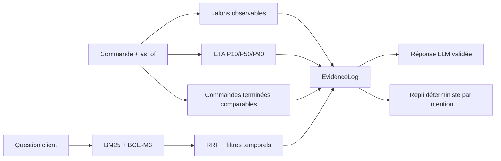

# BO4 — Assistant client fondé sur des preuves

## 1. Compréhension métier

BO4 explique une commande Olist à une date historique explicite (`as_of`). Il sépare faits observables, estimations, expériences historiques et actions. Olist n'est pas un suivi temps réel : aucune position GPS, cause exacte ou politique de remboursement n'est déduite.



### Architecture conversationnelle auditée

Avant cette évolution, `POST /api/bo4/ask` appelait directement
`CustomerAssistantAgent.answer_customer_question`. Cette méthode Python exécutait toujours contexte, ETA et recherche d'avis,
quel que soit le besoin exprimé. Le registre construisait l'agent avec `llm=None` : aucune détection d'intention, aucun historique
et aucun appel OpenRouter n'avaient lieu pendant l'inférence. Le rapport analytique affiché était donc entièrement déterministe.

L'orchestrateur actuel est `backend/app/llm/bo4.py::converse`. Quand OpenRouter est configuré, il transmet au modèle les schémas
de fonctions, laisse le modèle choisir les outils nécessaires, puis exécute ces appels dans une liste blanche Python. L'identifiant
de commande et la date `as_of` fournis par le modèle sont toujours remplacés par les valeurs autoritatives de l'application. La
réponse finale doit citer les preuves produites ; `verify_customer_narrative` rejette chiffres ou références inconnus, causalité
certaine, GPS et remboursement garanti. Sans clé, modèle compatible ou réponse valide, le classifieur conservateur Python choisit
un plan minimal et produit une réponse explicitement marquée comme repli déterministe.

Outils exposés au function calling :

- `get_order_context(order_id: str, as_of: str)` ;
- `get_order_timeline(order_id: str, as_of: str)` ;
- `predict_delivery_interval(order_id: str, as_of: str)` ;
- `find_similar_orders(order_id: str, as_of: str, k: int = 3)` ;
- `retrieve_similar_reviews(order_id: str, as_of: str, question: str, k: int = 3)` ;
- `get_customer_options(order_id: str, as_of: str)`, qui expose les actions générales autorisées et leurs limites comme garde-fou
  ShopInsight, sans les présenter comme une politique Olist.

Le client React conserve jusqu'à douze tours et les renvoie à chaque question. La réponse conversationnelle est prioritaire ; le
rapport structuré et ses preuves restent repliables. Le panneau debug optionnel expose intention, appels, arguments, résultats,
fournisseur/modèle, latence, références, validation et utilisation du repli.

## 2. Compréhension des données

Entrées : `features_{train,valid,test}.csv.gz`, `orders_analysis.csv.gz`, `reviews_text.jsonl.gz` et sa traduction française. La date individuelle `review_answered_at` (ou `review_created_at`) détermine la disponibilité d'un avis. Une issue n'est disponible qu'à `order_delivered_customer_date`.

Les données préparées et modèles ne sont pas versionnés. La reproduction réelle utilise les neuf CSV Olist originaux, dont les empreintes sont contrôlées par `prepare_data.py`. Les rapports agrégés reproductibles sont conservés sous `quality/`, sans publier les données ni les représentations vectorielles.

## 3. Préparation et audit de fuite

Les encodages cibles BO1/BO2 sont exclus : leurs plis OOF mélangés permettent à une observation ancienne d'utiliser des issues futures. BO4 conserve les variables disponibles à l'approbation, joint la cible par `order_id` et exige que l'issue ait été observée avant le fitting. Découpage : train octobre 2016–décembre 2017, sélection janvier–février 2018, calibration mars 2018, test avril–août 2018.

## 4. Modélisation et évaluation

Le benchmark compare quantiles globaux et régionaux, régression quantile linéaire, Gradient Boosting et LightGBM. Le critère combine Winkler et écart à la couverture 80 %. Le modèle choisi est réentraîné jusqu'au 1er mars puis conformalisé sur mars. Les durées négatives sont tronquées et les quantiles croisés remis en ordre. Un intervalle dépassé n'est jamais présenté comme ETA actuelle ; aucun modèle de temps restant n'est revendiqué.

Mesures : MAE, RMSE, pinball P10/P50/P90, PICP, MPIW et Winkler, globalement et par mois, État et nombre de vendeurs. La promesse marketplace est comparée séparément.

### Résultats réels

Sur la sélection chronologique, Gradient Boosting obtient le meilleur critère (MAE 4,302 jours, PICP 0,795, Winkler 19,779) devant les baselines empirique, régionale, linéaire et LightGBM. Après réentraînement et calibration conformale sur mars 2018, le test intact avril–août 2018 donne : MAE 3,846 jours, RMSE 5,923, pinball P10/P50/P90 0,591/1,923/1,266, PICP 0,762, MPIW 11,908 et Winkler 18,576 sur 32 150 commandes. La couverture sous la cible de 80 % est une limitation observée sous dérive temporelle, pas un résultat à masquer.

## 5. Recherche hybride

`HistoricalReviewIndex` reconstruit le corpus disponible à `as_of`, recalcule BM25 sur ce snapshot, ajoute facultativement BGE-M3, puis fusionne leurs classements par RRF. Sans index dense disponible, l'hybride se replie sur BM25 seul. Les filtres région/catégorie sont relâchés progressivement. Un résultat sans score BM25 positif ni similarité dense minimale n'est pas ajouté pour remplir `top-k`. Les commandes comparables doivent être livrées avant `as_of` et la cible est exclue.

`evaluate_bo4.py` compare BM25, BGE-M3 dense et leur fusion hybride sur 100 questions bilingues, puis produit un gabarit d'annotation. Precision@5, Recall@5, MRR et nDCG@5 ne doivent être calculés qu'après jugements humains ; le résultat reste explicitement en attente jusque-là.

L'exécution réelle indexe 42 687 avis en 1 024 dimensions avec BGE-M3 et FAISS. Le rapport conservé dans `quality/bo4_retrieval_results.json` est un résultat historique antérieur à la suppression de TF-IDF : sur 100 questions et avec le modèle en cache local, ses latences moyennes sont 84,4 ms (TF-IDF), 81,7 ms (BM25), 198,8 ms (dense) et 199,8 ms (ancien hybride à trois classements). Son pool contient 1 464 couples question–document à annoter ; aucune pertinence humaine n'a été inventée. Un nouveau benchmark n'est produit qu'en relançant explicitement l'évaluation avec les trois systèmes actuels.

## 6. Déploiement et sécurité

`CustomerAssistantAgent` expose `get_order_context`, `get_order_timeline`, `predict_delivery_interval`, `find_similar_orders`, `retrieve_similar_reviews`, `get_delivery_context` et `answer_customer_question`. Les preuves utilisent `ord:`, `mdl:` et `rev:`. Les avis sont du contenu non fiable, jamais des instructions. Le mode déterministe est le repli quand le LLM est absent ou invalide.

Avant production : authentification, autorisation d'appartenance de la commande, limitation de débit, journalisation sans données personnelles et politique de rétention sont obligatoires. Le prototype ne fournit pas ces garanties et affiche `historical_demo=true`.

### API

- `GET /api/bo4/orders/{order_id}/context?as_of=...`
- `GET /api/bo4/orders/{order_id}/eta?as_of=...`
- `GET /api/bo4/orders/{order_id}/similar?as_of=...&k=5`
- `POST /api/bo4/ask` avec `order_id`, `question`, `as_of`, `history` et le créneau `model` optionnel (`a` ou `b`)

### Reproduction

```powershell
python src/prepare_data.py --raw-dir data/raw --project-dir .
python src/build_model_features.py --project-dir .
pip install -r requirements.txt -r requirements-agents.txt -r requirements-api.txt -r requirements-bo4.txt
python src/train_bo4_models.py --project-dir .
python src/build_bo4_index.py --project-dir .
python src/evaluate_bo4.py --project-dir .
python src/evaluate_bo4_agent.py --project-dir . --scenarios 60
python tests/test_bo4.py -v
python tests/api/test_bo4_api.py -v
uvicorn backend.app.main:app --port 8000
cd frontend; npm ci; npm run dev
```

## Limites et améliorations

- Faire annoter la pertinence par des humains bilingues.
- La traduction française locale Marian reste une étape longue sur CPU ; le cache durable permet de reprendre avec `python src/translate_reviews.py --project-dir . --device cpu --checkpoint-rows 32`.
- Les 60 scénarios historiques réels réussissent les contrôles déterministes de faits, citations, temporalité et incertitude, ainsi que le rejet d'une réponse hallucinée. Cela ne remplace pas une évaluation humaine d'un LLM externe.
- Entraîner un modèle conditionnel de temps restant avant de proposer une ETA après expiration.
- Tester dérive temporelle, calibration conditionnelle et contrôle d'accès en environnement sécurisé.
